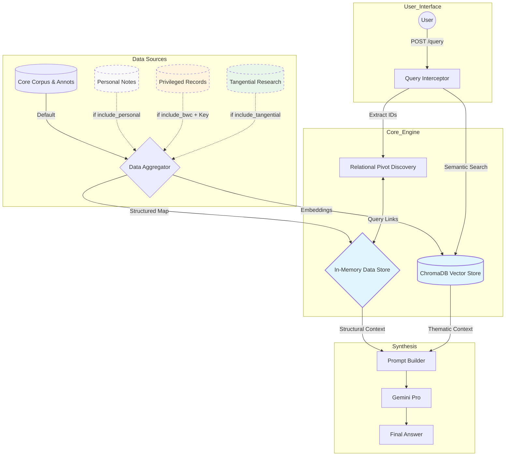

# GraphRAG Overview

> This describes the target design. See the [README](../README.md) for what `app.py` currently implements.

A GraphRAG is a powerful research tool that leverages an LLM but forces it prioritize answering research questions from a fixed set of documents and metadata. It significantly reduces hallucinations and enables complex reasoning through traversal of a structured knowledge graph.

## Why GraphRAG?

- The LLM Era: Early AI (like ChatGPT) showed promising breakthroughs, but relied on "memory" and often hallucinated details.
- The RAG Era: Retrieval Augmented Generation grounded AI in actual documents, acting like an "open book" search. It forced the LLM to use a specific set of relevant documents to answer the query.
- The GraphRAG Era (this system): This system leverages structured relationships (e.g., this Tablet was sent to this Person on this Date regarding this Famine). It uses a knowledge graph to "bridge" documents that aren't explicitly linked by text. This allows the system to discover links across documents that are stored in different languages or collections.

## What Kinds of Questions can it Answer?

The system was designed with the goal of answering the following types of questions, for example:

- Give me a detailed summary of the response of Bahá’u’lláh and the Bahá’í community to the widespread famines in Iraq from 1879 onwards. Were Huquq’u’llah funds used? If so, how?
- Here is a tablet from Bahá'u'llah that we know relatively little about. Help me situate this tablet within the larger context of the corpus of Bahá'u'llah's writings.
- Reason like a historian and help me determine the date of this work. Use all of the evidence available to you–the earliest manuscript dates, references in the work to historical events, etc. - Tell me your estimates for the earliest date and latest date but give me all of the evidence like a historian would.
- Tell me about the correspondence between Bahá’u’lláh and Varqa. Summarize the themes of their correspondence across all written exchanges.
- Use the authoritative translations of Shoghi Effendi to translate this passage. For all of the words in the passage, consult past authorized translations to see how Shoghi Effendi or other authorized translations chose to translate the word. Review your translation to make sure it is accurate and poetic.

## System Architecture & Philosophy

The system has a query interceptor that receives the user query, resolves entities, and extracts their identifiers. It then finds references to these identifiers in the knowledge graph and corpus. The corpus and knowledge graph are extensible. A user can maintain their own personal corpus and notes or be part of a team with privileged access to a private corpus and notes. Either or both can be pulled into context upon query or the query can target the core corpus. All of the annotation data returned is passed to an in-memory data store. In parallel, the system vectorizes the corpus for cross lingual semantic search. Both the in-memory data store and the results for querying the vector store are passed to the prompt builder which organizes the evidence and passes it to an LLM. The LLM synthesizes the evidence and returns a response with citations for each claim.

The technology is treated as ephemeral. The metadata constituting the knowledge graph is considered the central value that enables collective scholarship. The users of the system create a computational bibliography that grows more useful the more it is used.

## Diagram

